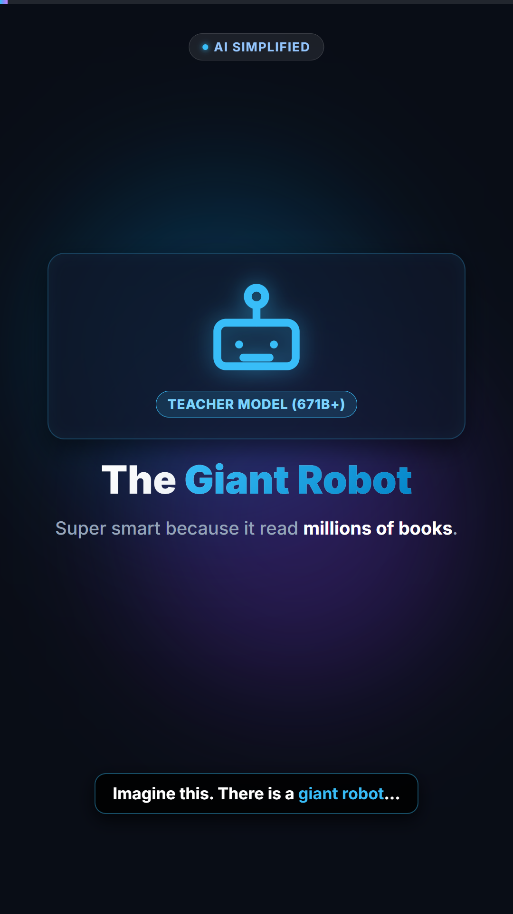

# 🤖 AI Knowledge Distillation — Code-Based Short Video

[](LICENSE)
[](https://github.com/heygen-com/hyperframes)
[](https://github.com/thewh1teagle/kokoro-onnx)
[](https://nodejs.org/)
[](https://www.python.org/)

An open-source, deterministic code-driven short video project explaining **AI Knowledge Distillation** using the analogy of a *"Giant Robot & Tiny Robot"* (like DeepSeek-R1 distilled into lightweight models you can run on mobile devices).

Built using **[HyperFrames](https://github.com/heygen-com/hyperframes)** (HTML, CSS, GSAP) and **[Kokoro-ONNX](https://github.com/thewh1teagle/kokoro-onnx)** for local, high-quality AI voiceover (`af_heart` voice).

---

## 📸 Visual Preview

| 9:16 Vertical (Reels / Twitter) | 1:1 Square (Feed Post) |
| :---: | :---: |
|  | *Optimized for Instagram & Twitter Feeds* |

> **Contact Sheet (All Scenes):** See [renders/snapshots/contact-sheet.jpg](renders/snapshots/contact-sheet.jpg) for the complete scene progression.

---

## 🎯 Formats Included

Both formats feature **dynamic synchronized subtitles** with keyword highlights and social media safe zones:

1. **9:16 Vertical (`1080 x 1920`)**:
   * File: `renders/robot-distillation-9x16.mp4`
   * Source: [`index.html`](index.html)
   * Best for: **Instagram Reels**, **TikTok**, **YouTube Shorts**, and **Twitter (X) Mobile**.
2. **1:1 Square (`1080 x 1080`)**:
   * File: `renders/robot-distillation-square.mp4`
   * Source: [`square.html`](square.html)
   * Best for: **Instagram Feed Post / Carousel** and **Twitter (X) Square Post**.

---

## 📂 Project Architecture

```text
├── index.html                  # 9:16 Vertical Composition (GSAP + Tailwind)
├── square.html                 # 1:1 Square Composition
├── full_voiceover.wav          # Master voiceover audio (Kokoro-ONNX af_heart)
├── timing.json                 # Scene & caption timing manifest
├── generate_voiceover.py       # Python TTS generation script (auto-downloads model)
├── package.json                # NPM scripts for preview, lint, and render
├── requirements.txt            # Python dependencies
├── hyperframes.json            # HyperFrames project configuration
├── meta.json                   # Project metadata
├── LICENSE                     # Apache-2.0 License
├── audio/                      # Individual scene audio clips (.wav)
├── renders/                    # Final rendered MP4 videos & snapshots
│   ├── robot-distillation-9x16.mp4
│   ├── robot-distillation-square.mp4
│   └── snapshots/              # Review snapshots & contact sheet
└── docs/
    └── skills.md               # AI Agent Skills & Developer reference
```

---

## ⚡ Prerequisites

1. **Node.js**: v22.0.0 or higher
2. **Python**: 3.10, 3.11, or 3.12
3. **FFmpeg**: v7.0+ on your system `PATH` (used by HyperFrames for deterministic audio muxing and frame encoding)
4. **Google Chrome**: Installed on your system (HyperFrames uses headless Chrome for GPU-accelerated frame capture)

---

## 🚀 Quickstart Guide

### 1. Clone the Repository
```bash
git clone https://github.com/your-username/ai-knowledge-distillation-video.git
cd ai-knowledge-distillation-video
```

### 2. Install Python & Node Dependencies
```bash
# Python TTS dependencies
pip install -r requirements.txt

# Node / HyperFrames dependencies
npm install
```

### 3. Generate Voiceover (Optional)
The repository already includes the pre-generated master audio [`full_voiceover.wav`](full_voiceover.wav) and [`timing.json`](timing.json). If you want to modify the script or regenerate with a different voice:
```bash
npm run voiceover
# or: python generate_voiceover.py
```
> **Note:** The script will automatically download `kokoro-v1.0.onnx` and `voices-v1.0.bin` into `models/` on its first run if they are not already cached.

### 4. Live Preview Studio in Browser
To preview the video with an interactive seekable scrubber and live hot-reloading:
```bash
# Preview 9:16 Vertical
npm run dev

# Preview 1:1 Square
npm run dev:square
```

### 5. Quality Assurance Check (Lint + Motion + Contrast)
Before rendering, run the comprehensive HyperFrames validation gate:
```bash
npm run check
```

### 6. Render Final MP4s
Render deterministic MP4 videos directly to the `renders/` directory:
```bash
# Render 9:16 Vertical (Reels / Twitter)
npm run render:9x16

# Render 1:1 Square (Feed)
npm run render:1x1

# Render both versions
npm run render:all
```

---

## 📋 Available NPM Scripts

| Command | Action |
| :--- | :--- |
| `npm run dev` | Opens the HyperFrames Studio live preview for 9:16 |
| `npm run dev:square` | Opens the live preview for 1:1 square |
| `npm run check` | Runs lint, runtime JS check, motion check, and contrast check |
| `npm run snapshot` | Captures keyframes as PNGs for review without full render |
| `npm run voiceover` | Runs Python script to regenerate voiceover and `timing.json` |
| `npm run render:9x16` | Renders `robot-distillation-9x16.mp4` |
| `npm run render:1x1` | Renders `robot-distillation-square.mp4` |
| `npm run render:all` | Renders both 9:16 and 1:1 videos sequentially |

---

## 🤖 AI Coding Agents & Skills

If you are editing this project using an AI coding agent (**Claude Code**, **Cursor**, **Codex**, or **Antigravity**), the project includes the native HyperFrames skills configuration.

Refer to [`docs/skills.md`](docs/skills.md) and [`AGENTS.md`](AGENTS.md) for framework-specific rules:
* How timeline registration works (`window.__timelines`).
* How to add audio tracks (music ducking, SFX).
* How to enforce deterministic frame-by-frame animations.

---

## 📱 Social Media Copy (Ready to Post)

### Instagram Reels / Feed (Bahasa Indonesia)
```text
Pernah dengar istilah "Knowledge Distillation" di dunia AI? 🤔

Bayangin robot raksasa yang super pintar karena sudah baca jutaan buku. Tapi badannya gede banget, boros listrik, dan jalannya lambat (kayak model AI ratusan miliar parameter). 🐘

Terus gimana biar kemampuan hebatnya bisa masuk ke robot kecil yang muat di HP kita? 📱⚡

Jawabannya: Model kecilnya cukup "berguru" langsung ke model besar! Tonton video ini sampai habis buat paham cara kerjanya dalam 1 menit. 🤖💡

---
#ai #artificialintelligence #knowledgedistillation #deepseek #deepseekr1 #machinelearning #techtok #belajarai #teknologi #programming
```

### Twitter / X (English)
```text
How does a massive AI model like DeepSeek-R1 run on a tiny smartphone? 📱🤖

It's all thanks to "Knowledge Distillation" — teaching small models the best shortcuts from giant models.

Here is the 1-minute breakdown: 👇
```

---

## 📄 License

Licensed under the **[Apache License 2.0](LICENSE)**. Free to use, adapt, and remix for personal and commercial projects.

